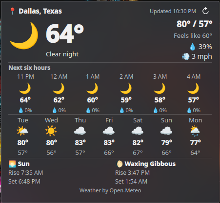

# Glance Weather

A compact desktop weather and astronomy widget for **KDE Plasma 6**, designed to show what matters without opening extra panels.



**Published stable release:** 1.0.0. **Current test build:** 1.0.2-rc.1 (not yet released). The 1.0.1 development candidates passed Bazzite and Nobara network-recovery and sleep/wake tests; 1.0.1 will not be published separately. The new 1.0.2 tooltips still need real Plasma testing.

## Features

- Current weather, including temperature, feels-like temperature, humidity, wind, and today's high/low
- Six-hour outlook with conditions, temperatures, and precipitation probabilities
- Seven-day forecast with daily high and low temperatures
- Sunrise, sunset, moonrise, moonset, and Moon-phase information
- Automatic weather updates and manual refresh
- Search by city or postal code, with configurable temperature and wind units
- Compact KDE Plasma 6 desktop layout

## Under test for 1.0.2

- Hover over the weather data timestamp to see when the forecast was last successfully fetched.
- Hover over a day in the seven-day outlook to see the approximate times of its warmest and coolest forecast hours.

These hover details use existing weather responses; they do not introduce additional API requests or raise the refresh frequency.

## Requirements

- KDE Plasma **6** (the package is not intended for Plasma 5)
- Working internet connection for forecast and place searches
- An emoji-capable font (appearance depends on the operating system)

Tested visually on **Bazzite** and **Nobara** Linux. The 1.0.1 recovery fixes passed sleep/wake and network-reconnection testing on both distributions. The two 1.0.2 tooltip improvements have not yet been validated in a running Plasma session. Other Plasma 6 configurations may render symbols or scaling differently.

## Install and upgrade

Download `glance-weather-1.0.2-rc.1.plasmoid`, open a terminal in the download directory, and run:

```bash
kpackagetool6 --type Plasma/Applet --install ./glance-weather-1.0.2-rc.1.plasmoid
```

To upgrade an existing Glance Weather installation, keeping saved settings:

```bash
kpackagetool6 --type Plasma/Applet --upgrade ./glance-weather-1.0.2-rc.1.plasmoid
systemctl --user restart plasma-plasmashell.service
```

The Plasma Shell restart refreshes already-loaded QML and briefly reloads panels. There is no need to restart the entire computer.

Right-click the desktop, choose **Add Widgets**, add **Glance Weather**, then open its configuration to select a location. The widget ships **without a preset city or coordinates**. The location search field's example is Seattle/98101; it is not an automatic selection.

To remove the widget entirely:

```bash
kpackagetool6 --type Plasma/Applet --remove com.github.nydgenga.glanceweather
```

To install directly from a source checkout:

```bash
kpackagetool6 --type Plasma/Applet --install ./package
```

## Privacy and network use

Glance Weather has no accounts, analytics or advertising code. Forecast requests send the selected coordinates to `https://api.open-meteo.com/v1/forecast`, and city/postal searches send search terms to `https://geocoding-api.open-meteo.com/v1/search`. The selected place and units are saved locally by Plasma; upgrading does not reset them. Check your chosen city before taking a public screenshot.

No hardcoded home city or ZIP is included as a default, and the release package contains no user screenshots. As with any network service, Open-Meteo can receive request metadata such as IP address.

## Data sources and attribution

Weather, astronomical data and place search are supplied by [Open-Meteo](https://open-meteo.com/), credited in the widget's footer. Open-Meteo weather data uses [CC BY 4.0](https://creativecommons.org/licenses/by/4.0/) attribution terms; the provider's free hosted API is limited to **noncommercial use** under its [current terms](https://open-meteo.com/en/terms). Commercial integrators should arrange an appropriate data service rather than assuming the free endpoint may be used commercially.

Moon phases are derived from Open-Meteo's daily numerical phase observations sampled at local **noon**. The widget estimates a current phase from consecutive noon samples, using a limited backward extrapolation before noon. The eight named phases are approximate intervals, **not exact astronomical event times**. The Moon may have no rise or set time on some local dates, shown as `—`.

## Limitations

- Plasma may retain an old desktop widget's saved size after a package update. The intended size is around 450 × 416 logical pixels; manually resize in Edit Mode when necessary.
- When deliberately resized much smaller, the content may scroll rather than become unreadably small.
- Forecasts require network access. A one-minute watchdog detects overdue refreshes after sleep and retries failed requests approximately every two minutes (plus up to one minute to check). If a retained forecast shows **Stale data**, hover over that label to read the actual request error; the Plasma user journal also records messages prefixed `Glance Weather:`. The in-memory last successful forecast can remain visible after a temporary request failure, but is lost after Plasma restarts.
- Appearance of Unicode emoji depends on installed fonts, theme and scaling; unusual values fit or clip rather than overlap adjacent forecasts.
- A location's local time is used for forecast hours and astronomical times, which can differ from the computer's timezone.
- Automated parser, layout-structure, numeric-stress and package checks supplement real-world KDE Plasma testing.

## Development

Pure JavaScript parsing and QML UI; no binary dependencies beyond the normal Plasma runtime. From the repository root:

```bash
node tests/test-weather.js
node tests/test-stress.js
node tests/test-layout.js
node tests/test-release.js
node tests/test-refresh.js
python3 scripts/package.py
```

The packaging script produces deterministic `.plasmoid` and source `.zip` archives in `dist/`. See [RELEASE_CHECKLIST.md](RELEASE_CHECKLIST.md) for release verification and [CHANGELOG.md](CHANGELOG.md) for the initial release changes.

## License and credits

Glance Weather source is released under the [Zero-Clause BSD license (0BSD)](LICENSE). The Open-Meteo weather data is separately licensed and attributed as noted above.

The widget was designed under the direction of its project maintainer, with code-development assistance from OpenAI's ChatGPT. This does not imply the maintainer personally authored every line.
